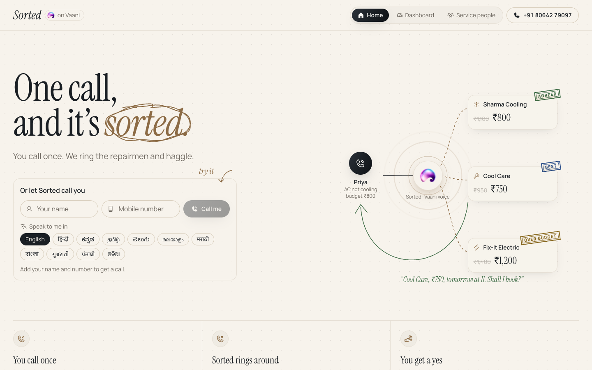
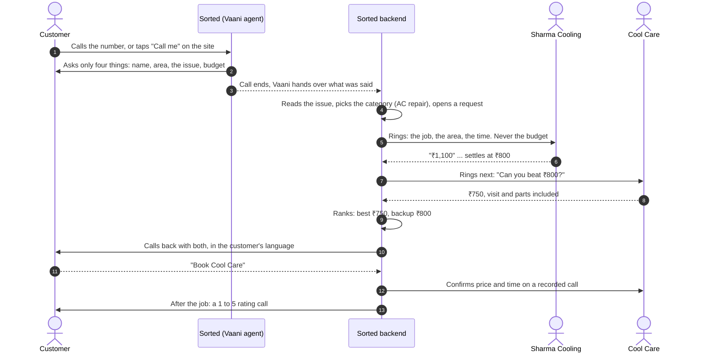
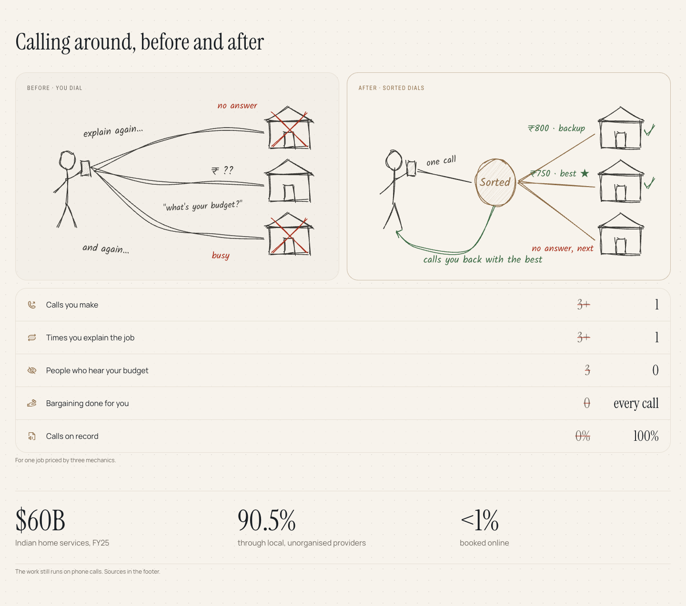
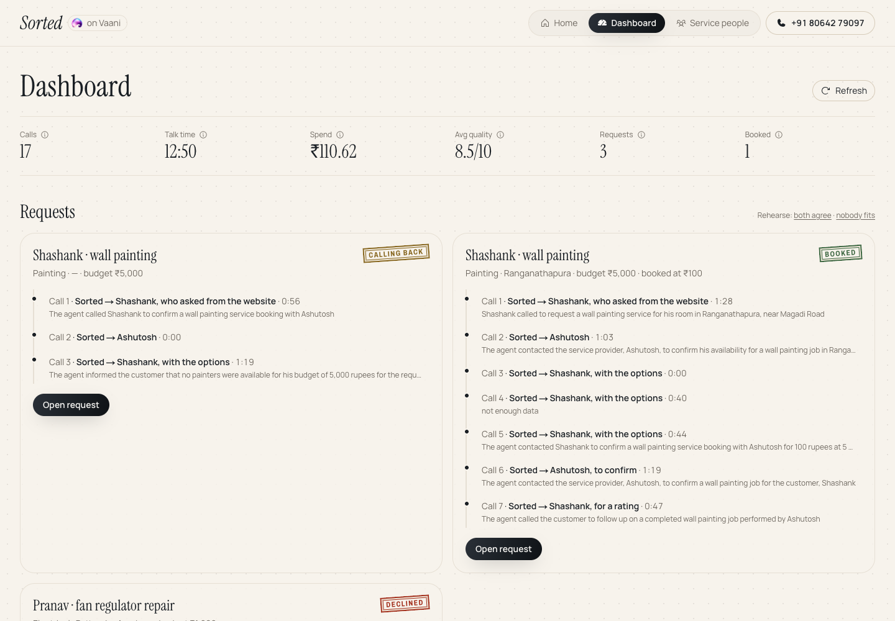
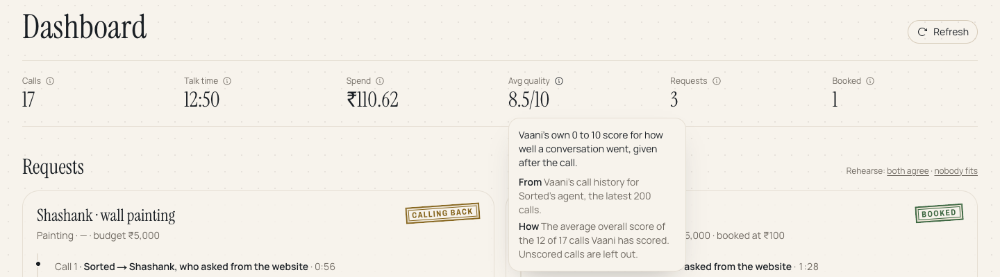
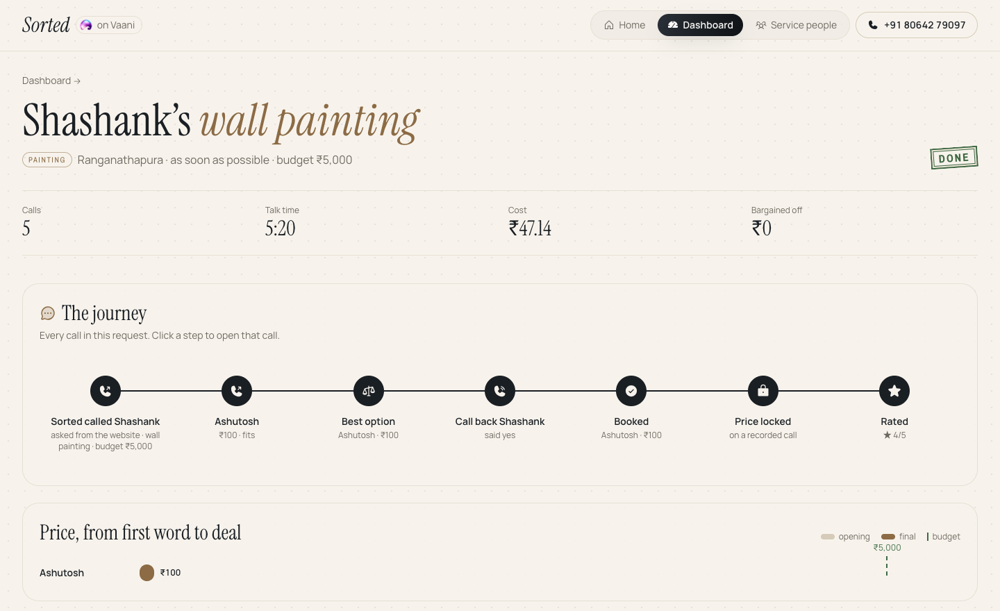
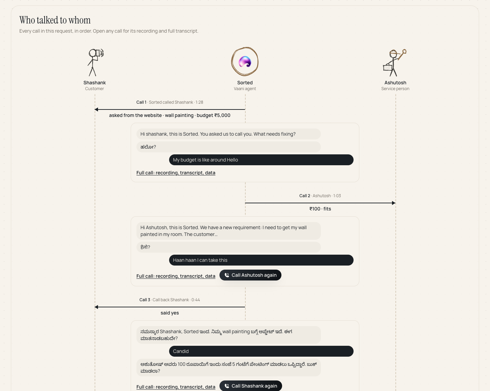
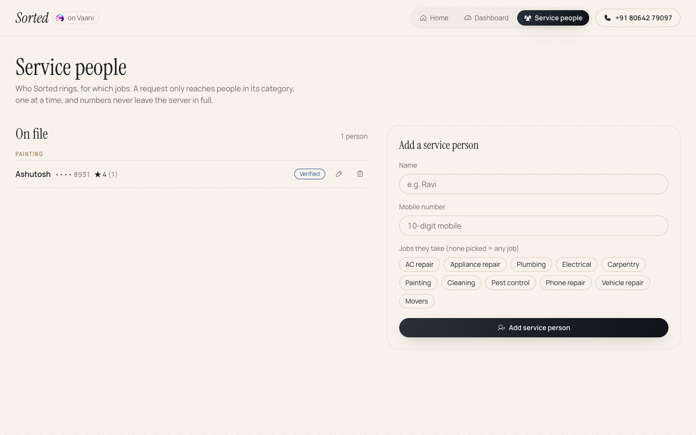
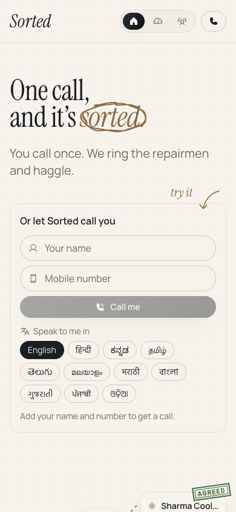
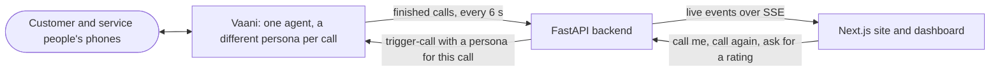

# Sorted

**One call, and it's sorted.** You tell Sorted what needs fixing, once. It rings the local repair people who do that kind of work, bargains with each one using the best quote so far, and calls you back with the best option and a backup, in your language. Say yes and it's booked, with the price confirmed on a recorded call.

Built on [Vaani](https://www.vaani.dev) for the Vaani Agent Buildathon. Call it: **+91 80642 79097**, or tap "Call me" on the site.



## How a request flows



If nobody fits the budget, Sorted calls back with the closest price and the customer can name a counter-offer, which Sorted takes back to them once. Customers can also call again to cancel or move the job, and Sorted tells the service person.

## Screenshots

**Before and after.** Calling around yourself, against one call to Sorted.



**Dashboard.** Every request, with the calls that make it up, and the numbers for the whole line.



Each number explains what it means, where it comes from and how it was worked out, with the live figures.



**One request, start to finish.** The journey across every call, and the price each person quoted.



**Who talked to whom.** The customer, Sorted and each service person each get a lifeline, and each call is an arrow. A real request from testing: the customer spoke Kannada and the painter Hindi, and Sorted spoke both. Any call can be opened for its recording and full transcript, or placed again.



**Service people.** Who Sorted rings, for which jobs. Add, edit, verify or remove them. Numbers never leave the server in full.



**On a phone.**



## What's inside

- **Sorts the job.** Reads the issue, picks one of 12 categories and rings only people who do that work, one at a time.
- **Keeps your budget secret.** Service people hear the job, the time and the area. Never your budget or your number.
- **Bargains with a rival quote.** Each next person hears the best price so far and is asked to beat it.
- **Understands any price.** ₹800, 800 to 1,000, visit plus parts, per hour, "1.5k", after inspection: all compared fairly.
- **Asks if it's all-in.** Visit charge and parts, said out loud, so there are no surprises at the door.
- **Best and a backup.** Cheapest firm price wins. Ties go to all-in, verified, better rated, then sooner.
- **Counter-offers for you.** Nobody fits? Name your price and Sorted goes back once more.
- **Your language, and theirs.** 11 Indian languages. Website calls use the one you pick; on inbound calls Sorted greets in English and then follows you. With service people it follows whatever they speak.
- **Shows what it saved.** From their opening price to the deal, in rupees.
- **Locks the price on record.** The service person confirms price and time on a recorded call.
- **Can't be talked round.** Prompt injection, fake staff, abuse and data fishing are refused and flagged. See [the calls we tried](docs/RED-TEAM.md).
- **Verified service people.** The operator vouches for people they've checked; they win ties.
- **Ratings by phone.** After the job Sorted asks for a 1 to 5, and good work gets more calls.
- **Cancel or move it by voice.** Call back and say so.
- **Every call on file.** Recording, transcript, summary, quality score and cost, live on the dashboard as calls happen.

## How it's built



- **One Vaani agent, many roles.** The intake, each service person's call, the callback, the price lock and the rating call all go out through Vaani's `trigger-call`, each with `modify_agent` giving that call its own prompt, greeting and language.
- **What was said becomes data.** Vaani's post-call extraction fills one schema shared by every kind of call (customer details, category, quotes, the customer's choice, rating). The backend reads it and decides the next call.
- **Voice.** Sarvam `saaras:v3` for speech to text and `bulbul:v3` for the voice, with language auto-detect; Deepgram and Cartesia as fallbacks.
- **Backend** (`backend/app.py`): polls Vaani's call history, runs the request (category, one person at a time, ranking, callback, booking, counter-offer, cancel and reschedule), keeps state across restarts and streams every step to the site. A webhook and tool endpoints are there for when it has a public URL.
- **Site** (`web/`): Next.js 16, Tailwind 4, Lenis, anime.js, rough.js for the pencil drawings, Phosphor icons and sonner toasts. The dashboard and request pages update live; a toast appears for each thing Sorted does.

## Run it

You need a Vaani account with an API key and a phone number, Python 3.11+ with [uv](https://docs.astral.sh/uv/), and Node 20+.

**1. Create the agent on Vaani.** Put your key in `.env` at the repo root (see `.env.example`), then:

```bash
uv run --with httpx --with fastapi --with pydantic agent/push.py
```

This creates the agent (or updates it, using the id saved in `agent/agent_id.txt`) with the prompt, voice, guardrails, extraction schema and number.

**2. Start the backend.** In `backend/.env`:

| Variable | What it's for |
|---|---|
| `VAANI_API_KEY` | Your Vaani key |
| `DOORMAN_KEY` | A shared secret between the site and the backend; pick any string |
| `DOORMAN_NUMBER` | Your Vaani number, e.g. `+918064279097` |
| `WAVE_SIZE`, `WAVE_TIMEOUT` | Optional. Service people rung at a time (1) and how long to wait for them (300 s) |
| `MAX_OPEN_TASKS`, `POLL_SECONDS` | Optional. Open requests allowed at once (5) and how often to check Vaani (6 s) |
| `NTFY_TOPIC` | Optional. An [ntfy](https://ntfy.sh) topic for phone notifications |

```bash
cd backend
uv run --with fastapi --with httpx --with uvicorn --with python-dotenv \
  uvicorn app:app --env-file .env --port 8787 --timeout-graceful-shutdown 2
```

Service people are added from the Service people page and kept in `backend/vendors.json`.

**3. Start the site.** In `web/.env.local`:

```bash
BACKEND_URL=http://127.0.0.1:8787
DOORMAN_KEY=the-same-secret-as-the-backend
NEXT_PUBLIC_SORTED_NUMBER="+91 80642 79097"
```

```bash
cd web
npm install
npm run dev
```

Open http://localhost:3000. To see a whole request without placing calls, use "Rehearse" on the dashboard.

**Tests:**

```bash
cd backend && uv run --with fastapi --with httpx --with pytest pytest -q
```

## In this repo

| Path | What's there |
|---|---|
| `agent/` | The agent's prompt, voice settings and `push.py`, which creates it on Vaani |
| `backend/` | The FastAPI backend and its tests |
| `web/` | The Next.js site: home page, dashboard, request pages, service people |
| `docs/RED-TEAM.md` | The calls we made to try to break Sorted, and what it did |
| `DESIGN.md` | The visual system |

## Credits

Voice, calls, transcripts and call analysis by [Vaani](https://www.vaani.dev). The market figures on the home page are sourced in its footer.
